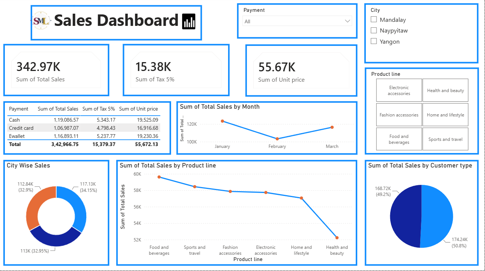

# Sales & Business Performance Dashboard

An interactive **Power BI** dashboard that analyzes supermarket sales: where sales come from, which products sell best, how customers pay and how sales change month to month.

## Tools Used
- **Power BI Desktop**: data model, DAX measures and interactive visuals

## Dataset
- **Supermarket Sales** dataset (Kaggle): 1,000 transactions from 3 supermarket branches in Myanmar (Yangon, Mandalay, Naypyitaw), January to March 2019
- Columns include invoice ID, branch, city, customer type, gender, product line, unit price, quantity, tax, total, date, time, payment method, cost of goods sold, gross income and rating

## Dashboard Features
- **KPI cards:** Total Sales, Total Tax (5%) and Total Unit Price
- **Slicers:** filter the whole report by **Payment method**, **City** and **Product line**
- **Visuals:**
  - Sales, tax and unit price by payment method (table)
  - Sales trend by month (line chart)
  - City-wise sales (donut chart)
  - Sales by product line (line chart)
  - Sales by customer type: Member vs Normal (pie chart)
- **DAX measures / calculated fields** such as *Total Sales* and *Delivery Charge*

## Key Insights
- **Food & Beverages** is the top-selling product line; **Health & Beauty** is the lowest.
- **January** had the highest sales of the quarter and **February** the lowest.
- Sales are split almost evenly across the **three cities** (about 33% each) and between **Member and Normal customers** (about 50% each).
- **Cash** is the most used payment method by sales value, closely followed by e-wallet and credit card.

## How to Open
1. Download `Sales_Dashboard.pbix` from this repository.
2. Open it in [Power BI Desktop](https://powerbi.microsoft.com/desktop/) (free, Windows).

## Author
**Shweta Lokhande** · [LinkedIn](https://www.linkedin.com/in/shweta-lokhande-aa12b4304) · [GitHub](https://github.com/Shwetaml108)
